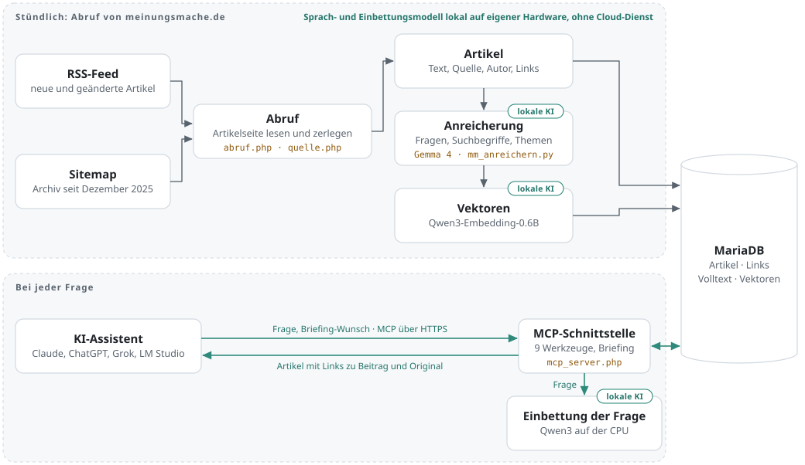

# Rede mit Meinungsmache

Eine MCP-Schnittstelle zu den Artikeln der Nachrichtenseite **[meinungsmache.de](https://meinungsmache.de)**. Über sie lassen sich KI-Assistenten wie Claude, ChatGPT, Grok oder lokale Modelle in LM Studio mit den Nachrichten verbinden. Sie beantworten Fragen zu aktuellen Themen oder stellen ein Morgen- oder Abendbriefing zusammen, jeweils mit Link zum Beitrag auf meinungsmache.de und zur Originalquelle.

- **Projektseite:** <https://poc.deutschkaemer.info/meinungsmache/>
- **Connector-Adresse:** `https://poc.deutschkaemer.info/meinungsmache/mcp`
- **Quelle:** <https://meinungsmache.de> (RSS: <https://meinungsmache.de/rss/all>)

Das Projekt ist ein Proof of Concept auf [poc.deutschkaemer.info](https://poc.deutschkaemer.info/), mit Zustimmung des Betreibers von meinungsmache.de. Es ist inoffiziell; maßgeblich sind die Artikel auf meinungsmache.de. Schwesterprojekt mit demselben Aufbau: [rede-mit-dem-afd-gutachten](https://github.com/rony-x2/rede-mit-dem-afd-gutachten).

## Was die Schnittstelle kann

meinungsmache.de veröffentlicht zwei Arten von Artikeln: **Meldungen**, die einen Bericht eines anderen Mediums zusammenfassen und das Original verlinken (etwa Tagesschau, Die Zeit, Süddeutsche Zeitung), und **eigene Artikel** der Redaktion, oft Erfahrungsberichte, Analysen oder Meinungsbeiträge. Ein Abruf holt sie stündlich, das Archiv reicht zurück bis Dezember 2025.

| Werkzeug | Zweck |
|---|---|
| `briefing` | alle Artikel eines Zeitraums für ein Briefing: `morgen` (seit gestern 18 Uhr), `abend` (seit heute 6 Uhr), `tag`, `woche` oder ab einem Zeitpunkt, mit Themen und wahlweise auf ein Thema eingegrenzt |
| `neueste` | Artikel nach Zeit, wahlweise nach Zeitraum, Quelle, Art, Autor oder Thema gefiltert |
| `bedeutung_suchen` | Suche nach Bedeutung: Frage in eigenen Worten (Vektoren und Volltext zusammen) |
| `suchen` | Volltextsuche in Titel, Dachzeile und Text |
| `artikel_lesen` | ein Artikel vollständig, mit Quelle, Link zum Original und den Links im Text |
| `quellen` | aus welchen Medien die Meldungen stammen; Autorinnen und Autoren der eigenen Artikel |
| `ueberblick` | Umfang, Zeitraum, Stand des letzten Abrufs |
| `search`, `fetch` | vereinfachte Suche für Clients, die nur diese beiden Werkzeuge kennen |

Die Schnittstelle gibt dem Modell Regeln für die Antwort mit: wiedergeben, was auf meinungsmache.de steht, und das kenntlich machen; bei Meldungen die Originalquelle nennen und verlinken; Meinungsbeiträge als Meinung kennzeichnen; keine eigene Bewertung hinzufügen; zusammenfassen statt vollständig wiedergeben. Einzelheiten in [docs/werkzeuge.md](docs/werkzeuge.md).

## Wie es funktioniert

<picture>
  <source media="(prefers-color-scheme: dark)" srcset="docs/bilder/ablauf-dunkel.svg">
  
</picture>

1. **Abruf:** `abruf.php` läuft stündlich per Cron. Es liest den RSS-Feed, holt neue Artikel von ihrer Seite und zerlegt sie in Titel, Dachzeile, Text, Quelle oder Autor, Link zum Original und die Links im Text. Junge Artikel werden einige Male erneut geprüft, falls sie nachträglich bearbeitet wurden ([docs/abruf.md](docs/abruf.md)).
2. **Anreicherung:** Ein großes Sprachmodell (Gemma 4 26B-A4B auf eigener Grafikkarte) schreibt zu jedem Artikel Fragen in Alltagssprache, Suchbegriffe und ein bis drei Themen. Ein kleines Programm auf dem Rechner mit der Karte holt sich die Arbeit stündlich ab ([docs/anreicherung.md](docs/anreicherung.md)).
3. **Vektoren:** Artikeltext und erzeugte Fragen werden mit Qwen3-Embedding-0.6B eingebettet, lange Artikel in Teilen zu 350 Wörtern. Beide Modelle laufen auf eigener Hardware, ohne Cloud-Dienst.
4. **Suche:** `bedeutung_suchen` bettet die Frage ein, vergleicht sie mit den erzeugten Fragen und den Textteilen und führt beide Ranglisten zusammen (Reciprocal Rank Fusion). In einem Testsatz mit 34 Alltagsfragen steht der passende Artikel damit bei 31 auf Platz 1 und bei allen unter den ersten fünf, vorher bei 25 und 32 ([docs/anreicherung.md](docs/anreicherung.md#messung)).
5. **Schnittstelle:** `mcp_server.php` spricht MCP über Streamable HTTP (Protokoll 2025-11-25, 2025-06-18 und 2025-03-26). Ein Konto ist nicht nötig, und es wird nur lesend zugegriffen.

## Verzeichnisse

| Verzeichnis | Inhalt |
|---|---|
| [`server/lib/`](server/lib) | Abruf (`abruf.php`, `quelle.php`), Anreicherung (`anreicherung.php`), MCP-Server, Datenbankzugang, Tabellenschema |
| [`arbeiter/`](arbeiter) | `mm_anreichern.py` für den Rechner mit der Grafikkarte |
| [`messung/`](messung) | Testsatz mit 34 Fragen, Messung über die Schnittstelle und Vergleich von Varianten auf dem Server |
| [`server/web/`](server/web) | öffentlicher Teil: Einstieg `mcp.php`, `stand.php` für die Projektseite, `anreicherung.php` für den Arbeiter, Umleitung, Zeichen und Favicons |
| [`seite/`](seite) | Projektseite: gebaute Seite (`index.html`), Vorlage, Bauskript, Diagramm, Zeichen, CSS (auch das gemeinsame `style.css` der PoC-Seite), JavaScript, Logos |
| [`docs/`](docs) | Dokumentation, Diagramme unter `docs/bilder/` (erzeugt von `seite/diagramm.py`) |

## Dokumentation

- [docs/abruf.md](docs/abruf.md): Quellen, Zerlegung der Artikelseiten, Aktualisierung, Einbettung, Grenzen
- [docs/anreicherung.md](docs/anreicherung.md): Fragen, Suchbegriffe und Themen von einem lokalen Sprachmodell, Arbeiter, Messung
- [docs/werkzeuge.md](docs/werkzeuge.md): Protokoll, Werkzeuge, Briefing, Anweisungen an das Modell, Einbindung in Clients
- [docs/server.md](docs/server.md): Voraussetzungen, Verzeichnisse, Datenbank, Cron, Einbettungsdienst, Betrieb
- [docs/projektseite.md](docs/projektseite.md): Aufbau und Gestaltung der Projektseite, Zeichen, Bauen

## Selbst betreiben

Kurzfassung, ausführlich in [docs/server.md](docs/server.md):

```bash
# Bibliothek außerhalb des Webroots, öffentlicher Teil im Webroot
mkdir -p ~/poc/mm ~/public_html/poc/meinungsmache
cp server/lib/* ~/poc/mm/
cp server/web/* server/web/.htaccess ~/public_html/poc/meinungsmache/
cp server/config.beispiel.php ~/poc/config.php   # Zugangsdaten eintragen

# Erster Lauf mit Archiv (legt die Tabellen an), danach stündlich
php ~/poc/mm/abruf.php --nachholen
( crontab -l; echo '17 * * * * flock -n $HOME/.tmp/mm_abruf.lck php $HOME/poc/mm/abruf.php --still' ) | crontab -
```

Für eine andere Nachrichtenseite mit RSS-Feed sind vor allem die Adressen und die Zerlegung der Artikelseite in `quelle.php` anzupassen.

## Lizenzen

- **Programmcode:** MIT-Lizenz, siehe [LICENSE](LICENSE).
- **Artikel:** © meinungsmache.de bzw. die Originalmedien. Das Repository enthält keine Artikel; sie entstehen beim Abruf in der eigenen Datenbank. Wer die Schnittstelle für eine Seite betreibt, braucht dafür deren Zustimmung.
- **Logos unter `seite/logos/`:** Marken der jeweiligen Anbieter (Anthropic, OpenAI, xAI, LM Studio). Sie dienen nur zur Kennzeichnung der Einrichtungsanleitungen.

## Einordnung

meinungsmache.de wählt Themen aus und ordnet sie teils wertend ein. Die Schnittstelle macht die Artikel durchsuchbar und zitierbar, bewertet sie aber nicht. Für eine ausgewogene Einordnung braucht es weitere Quellen; die Schnittstelle weist die Modelle darauf hin.

Fehler oder Hinweise bitte per E-Mail an dennis@deutschkaemer.info oder als [Issue](../../issues).
