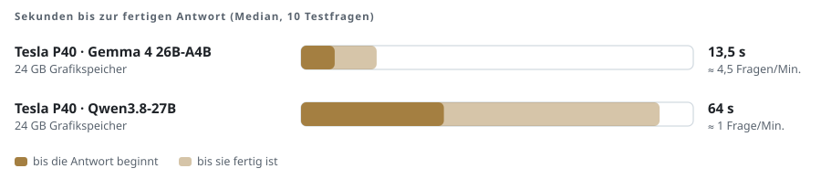

# Ausblick: ein Angebot direkt auf meinungsmache.de

Bisher braucht man einen eigenen KI-Assistenten, um mit den Nachrichten zu sprechen. meinungsmache.de könnte das auch selbst anbieten, ohne Konto und ohne Einrichtung. Die Schnittstelle bliebe dafür unverändert; dazu käme ein Sprachmodell, das sie benutzt. Drei Wege wären denkbar, umgesetzt ist keiner davon. Die Projektseite fasst sie für Leserinnen und Leser ohne technisches Vorwissen zusammen ([Ausblick](https://poc.deutschkaemer.info/meinungsmache/#ausblick)); hier stehen die Einzelheiten. Aufbau und Vorgehen folgen dem [Ausblick des Schwesterprojekts](https://github.com/rony-x2/rede-mit-dem-afd-gutachten/blob/main/docs/ausblick.md).

## Fall 1: fertiges Briefing, morgens und abends

Ein geplanter Lauf ruft zweimal am Tag ein Sprachmodell mit dem Werkzeug `briefing` auf (`zeitraum` = `morgen` bzw. `abend`) und veröffentlicht das Ergebnis als Seite, im RSS-Feed oder als Newsletter. Alle bekommen dasselbe Briefing; auf Wunsch gibt die Redaktion es vorher frei.

- **Technik:** ein Skript nach dem Muster von [`messung/chat_probe.py`](../messung/chat_probe.py) (Vermittler zwischen Modell und Schnittstelle), per Cron um etwa 7 und 18 Uhr, Ausgabe als HTML-Seite oder RSS-Eintrag.
- **Modell:** Auf eigener Hardware genügt eine Karte mit 24 GB; im Testlauf dauerte ein Briefing mit Gemma 4 26B-A4B 10 bis 15 Sekunden. Bei einem Anbieter siehe die Kosten unten.
- **Vorteile:** keine Last durch Besucherinnen und Besucher, keine personenbezogenen Daten, jedes Briefing lässt sich vor dem Erscheinen prüfen.
- **Grenze:** keine Rückfragen. Dafür braucht es Fall 2 oder 3.

## Fall 2: Chat über einen KI-Anbieter

Wie beim Gutachten: Ein kleiner Endpunkt auf dem Webserver nimmt die Frage aus dem Chatfenster entgegen und ruft die Messages API von Anthropic mit dem MCP-Connector auf (Beispiel auf der [Projektseite](https://poc.deutschkaemer.info/meinungsmache/#entwickler)). Der Anbieter ruft die Werkzeuge selbst auf, die Antwort kommt als Stream zurück. Nötig sind ein API-Konto mit Ausgabenlimit, der Endpunkt und ein Vertrag zur Auftragsverarbeitung; die Fragen gehen an Anthropic in die USA.

### Kosten

Eine Frage braucht hier deutlich weniger Text als beim Gutachten, weil die Artikel kurz sind. Im Testlauf (Fall 3) lagen die Eingaben je Frage, über alle Schritte zusammengezählt und samt Werkzeugbeschreibungen, im Mittel bei rund 3.300 Token (Gemma 4, zwei Schritte) bzw. 6.900 Token (Qwen3.8, meist drei Schritte), höchstens bei 14.000. Gerechnet ist mit **5.000 bis 10.000 Token Eingabe und rund 500 Token Ausgabe** je Frage. Listenpreise je Million Token in US-Dollar (Stand November 2026), umgerechnet mit 1,0989 US-Dollar je Euro (EZB-Referenzkurs Mitte November 2026):

| Modell | Eingabe | Ausgabe | je Frage | 1.000 Fragen |
|---|---|---|---|---|
| Claude Haiku 5.5 | 0,10 US-$ | 0,50 US-$ | ≈ 0,07 bis 0,11 Cent | ≈ 1 € |
| Claude Sonnet 5.5 | 2 US-$ | 10 US-$ | ≈ 1,4 bis 2,3 Cent | ≈ 14 bis 23 € |
| Claude Opus 5.5 | 4 US-$ | 20 US-$ | ≈ 2,7 bis 4,6 Cent | ≈ 27 bis 46 € |

Für Fall 1 (ein Briefing mit 5.000 bis 10.000 Token Eingabe, zweimal am Tag, 60 im Monat) ergibt das mit Haiku wenige Cent und mit Sonnet etwa 0,80 bis 1,40 Euro im Monat.

## Fall 3: Chat mit frei verfügbaren Modellen auf lokaler Hardware

Die Frage geht vom Webserver über eine gesicherte Verbindung (SSH-Tunnel oder WireGuard) zu einem eigenen Rechner mit Grafikkarte. Dort führt ein Vermittler die Unterhaltung mit dem Modell (llama-server, OpenAI-artige Schnittstelle mit Werkzeugaufrufen) und reicht dessen Werkzeugaufrufe per MCP an die Schnittstelle weiter. Der Modellserver ruft selbst keine Werkzeuge auf.

### Probelauf

Gemessen am 21. November 2026 mit [`messung/chat_probe.py`](../messung/chat_probe.py) auf einer Tesla P40 (24 GB):

- zwei Briefings („Mach mir ein kurzes Abendbriefing“, „Was gab es in der letzten Woche zu Klima und Umwelt?“) und acht Fragen aus dem [Testsatz](../messung/testsatz.json), darunter solche mit anderen Wörtern als im Artikel,
- als echter Chat: Das Modell bekommt die Werkzeuge der Schnittstelle, ruft sie selbst auf und antwortet mit Links,
- Modell vollständig im Grafikspeicher (`-ngl 99 -fit off`), 32.000 Token Kontext, ohne Denkmodus,
- „passender Artikel“: Die Antwort verlinkt einen der Artikel, die im Testsatz als passend markiert sind; bei Briefings mindestens drei Artikel des Zeitraums.

<picture>
  <source media="(prefers-color-scheme: dark)" srcset="bilder/probelauf-dunkel.svg">
  
</picture>

| Modell | je Antwort (Median) | Antwort beginnt nach | Fragen pro Minute | Briefing | passender Artikel verlinkt | Schritte |
|---|---|---|---|---|---|---|
| Gemma 4 26B-A4B | 13,5 s | 6,0 s | ≈ 4,5 | 10–14 s | 10/10 | 2 |
| Qwen3.8-27B | 64 s | 25,5 s | ≈ 1 | 44–59 s | 10/10 | meist 3 |

Beobachtungen:

- **Gemma 4** antwortet schnell und knapp (im Median 121 Wörter), meist nach einem einzigen Werkzeugaufruf. Im ersten Durchgang fand es bei „Wie teuer ist Tanken gerade?“ nichts: Es suchte mit `suchen` nach fünf Wörtern zugleich, und kein Artikel enthielt alle. Seitdem weicht `suchen` in diesem Fall auf einzelne Wörter aus und nennt dazu `bedeutung_suchen`; im zweiten Durchgang (Tabelle) passten alle zehn.
- **Qwen3.8** sucht gründlicher (oft eine zweite Suche und meist ein bis vier Artikel vollständig nachgelesen), nennt öfter Datum und Quelle und schreibt „laut meinungsmache.de“, braucht dafür aber etwa fünfmal so lange.
- Verglichen mit dem Gutachten kommen die Antworten deutlich schneller, weil die Werkzeuge kürzere Texte zurückgeben.

Einschätzung: Für Fall 1 reicht eine Karte wie die P40 mit großem Abstand. Für einen Chat mit mäßigem Andrang genügt sie mit Gemma 4; mit 24 GB passt eine Unterhaltung zur Zeit in den Speicher, weitere warten kurz. Die Rohdaten stehen in `messung/probe_*.jsonl` (`probe_gemma_vorher.jsonl` ist der erste Durchgang vor der Änderung an `suchen`).

## Was jeder Weg braucht

- **Kennzeichnung:** sagen, dass ein Sprachmodell schreibt, welches es ist und dass es sich irren kann; Links immer zum Artikel und zur Originalquelle.
- **Einordnung wie in der Redaktion:** Meldungen mit Quelle, Meinungsbeiträge als Meinung, keine eigene Wertung des Modells. Das geben die Anweisungen der Schnittstelle bereits vor.
- **Prüfung vor dem Start:** Briefings und Antworten mit festen Testfragen gegenprüfen.
- **Schutz vor Missbrauch** (Chat): begrenzte Zahl an Anfragen je Anschluss, Bindung an die Nachrichten der Seite, Hinweis bei Überlast.
- **Rechtlicher Rahmen:** Impressum und Datenschutzerklärung passend zum Weg, beim Anbieter ein Vertrag zur Auftragsverarbeitung. Die Rechte der Originalmedien bleiben gewahrt, weil nur zusammengefasst und verlinkt wird.
- **Betreuung:** Kosten, Auslastung und Rückmeldungen im Blick behalten; ein Briefing auch einmal zurückhalten können.

Die Wege lassen sich verbinden: das fertige Briefing als Einstieg, ein Chat für Nachfragen, lokale Hardware als Normalfall und der Anbieter als Ausweichweg bei hoher Last.
